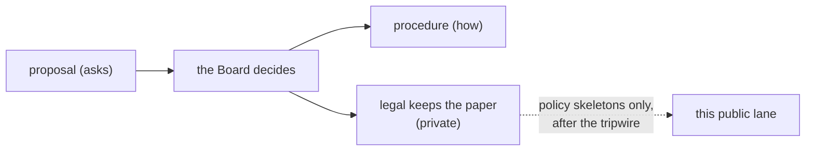

<picture>
  <source media="(prefers-color-scheme: dark)" srcset="https://raw.githubusercontent.com/psychedelicsinrecovery/.github/main/profile/assets/banner-dark.svg">
  
</picture>

#  Psychedelics in Recovery®: legal (public lane)

*How PIR® keeps its paperwork, and the shape of the policies it holds itself to. The paperwork itself stays private.*

> [!NOTE]
>  **What this is.** A narrow public window onto PIR®'s private `legal` repository: this page (the folder map) and the
> policy skeletons an officer has listed, copied by a sync after a tripwire that reads every word. Nothing here is edited
> by hand, and nothing here is legal advice.

##  The folder map (the private repository)

| | Folder | What it holds | Here? |
|---|---|---|---|
|  | `entity/` | formation papers, bylaws as filed, the IRS determination letter, state registrations, the officer roster | never |
|  | `tax/` | returns and their working papers, one folder per year | never |
|  | `filings/` | annual reports, charity registrations, trademark filings | never |
|  | `counsel/` | questions for a CPA or an attorney and their answers | never |
|  | `policies/` | PIR®'s own written policies | **skeletons only**, below |

##  Policy skeletons

| | Policy | Status |
|---|---|---|
|  | [Conflict of interest](policies/conflict-of-interest.md) | adopted: Article X of the [bylaws](https://github.com/psychedelicsinrecovery/.github/blob/main/bylaws.md) |
|  | [Gift acceptance](policies/gift-acceptance.md) | skeleton |
|  | [Treasury and digital assets](policies/treasury-and-digital-assets.md) | skeleton |
|  | [Document retention](policies/document-retention.md) | skeleton |

##  More

-  [PIR®'s public reading room](https://psychedelicsinrecovery.github.io/reading-room-public/) · [public procedures](https://github.com/psychedelicsinrecovery/ops-standard-operating-procedures-public)
-  Officers and the Board read the private repository, [`legal`](https://github.com/psychedelicsinrecovery/legal) (sign in; a 404 means it is not for your account).
-  The convention every organisation in the family shares: [LEGAL-REPO.md](https://github.com/drasticstatic/my-template/blob/main/org-onboarding/LEGAL-REPO.md).

Published from PIR®'s private `legal` by an allowlist (SOP-OPS-003, *Private houses everything, public lanes witness*). Icons: Lucide (ISC).
